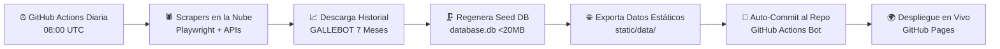

# 🛒 SuperComparador Multitienda (Cloud & Autónomo)

Sistema integral y **100% autónomo** de **comparación de precios en supermercados argentinos**, relevamiento automatizado mediante scrapers en la nube (GitHub Actions), auditoría de ofertas contra series históricas de 7 meses y **escáner móvil de códigos de barra en góndola**.


---

## ⚡ ¿Cómo funciona la arquitectura 100% autónoma?

Este repositorio está diseñado para funcionar **sin depender de que tu computadora esté encendida ni de configuraciones manuales locales**:



1. **Relevamiento Programado en la Nube:** Un flujo de [GitHub Actions](.github/workflows/daily-scraper.yml) se ejecuta todos los días a las 05:00 AM (hora argentina) en los servidores de GitHub.
2. **Ejecución de Scrapers:** Ejecuta los scrapers de **La Gallega, COTO, Carrefour, Jumbo, La Reina y La Anónima**, y descarga el histórico de precios consolidado.
3. **Optimización de Tamaño (<50 MB):** Mantiene la base de datos `database.db` en ~15 MB y genera los índices estáticos en `static/data/`.
4. **Auto-commit & Despliegue:** Guarda los datos actualizados en el repositorio y los publica automáticamente en **GitHub Pages**.
5. **Acceso Móvil en Góndola:** Podés abrir la web desde tu celular con datos móviles (4G/5G) en cualquier supermercado, escanear códigos de barra con la cámara y ver la comparativa al instante.

---

## 🌟 Características Principales

- **📱 Escáner de Código de Barras en Góndola:**
  - Visor en vivo con animación láser, linterna y selector de cámaras.
  - **Modo Foto Directa (`capture="environment"`):** Para capturar el código rápidamente sin restricciones de streaming de video.
  - Alarma sonora (*beep*) y respuesta háptica (vibración) al detectar el código.
  - Botones de prueba rápida con códigos reales (3D's Queso, Palitos Swift, Nescao, Rexona Cotton, Aceite Zuccardi).

- **⚖️ Comparativa Multitienda en Tiempo Real:**
  - Precios comparados entre **La Gallega, COTO, Carrefour, La Reina, Jumbo y La Anónima**.
  - Identificación del mejor precio y cálculo del ahorro máximo.
  - Desglose de promociones por unidad (*2x1*, *2da al 70%*, *3x2*, ofertas directas).

- **📈 Auditoría Histórica de 7 Meses:**
  - Gráfico interactivo diario de evolución de precios (febrero a hoy).
  - Detección algorítmica de **Oferta Real** vs **Oferta Inflada / Falsa Oferta**.
  - Cálculo de porcentaje de inflación acumulada por artículo.

- **🧺 Canasta Inteligente:**
  - Armá tu carrito y compará cuánto te costaría la compra total en cada supermercado.

---

## 🚀 Despliegue en GitHub (1 solo paso)

El repositorio local ya está inicializado y con el commit creado. Para publicarlo:

1. Creá un repositorio vacío en [GitHub](https://github.com/new) llamado `super-comparador`.
2. Ejecutá en tu consola dentro de la carpeta del proyecto:
   ```powershell
   git remote add origin https://github.com/arqderman-tech/super-comparador.git
   git push -u origin main
   ```
3. **Activar GitHub Pages (opcional, automático con Actions):**
   - En tu repo en GitHub ve a **Settings > Pages**.
   - En **Build and deployment > Source**, seleccioná **GitHub Actions**.
   - ¡Listo! Tu app estará activa en `https://arqderman-tech.github.io/super-comparador/`.

---

## 💻 Ejecución Local (Opcional)

Si querés probar la aplicación en tu computadora localmente:

1. **Instalar dependencias:**
   ```bash
   pip install -r requirements.txt
   ```
2. **Iniciar servidor:**
   Hacé doble clic en [`run_app.bat`](run_app.bat) o ejecutá:
   ```bash
   python -X utf8 server.py
   ```
3. Abrí en tu navegador: [http://localhost:8000](http://localhost:8000)

---

## ☁️ Despliegue del Backend Dinámico (Docker / Render)

Si además querés tener el servidor FastAPI dinámico corriendo 24/7 en la nube:
- Incluye [`Dockerfile`](Dockerfile) y [`render.yaml`](render.yaml).
- Podés vincular tu repositorio en [Render.com](https://render.com) (Plan gratuito) para tener tu API y UI activas en un subdominio `.onrender.com`.

---

## 🛠️ Tecnologías

- **Scraping en Nube:** GitHub Actions, Playwright, BeautifulSoup4, Requests, Curl-Cffi.
- **Frontend Híbrido:** Vanilla JS, TailwindCSS, FontAwesome 6, Chart.js, HTML5-QRCode.
- **Backend / Datos:** FastAPI, Uvicorn, SQLite3 (FTS5), JSON estáticos optimizados.
